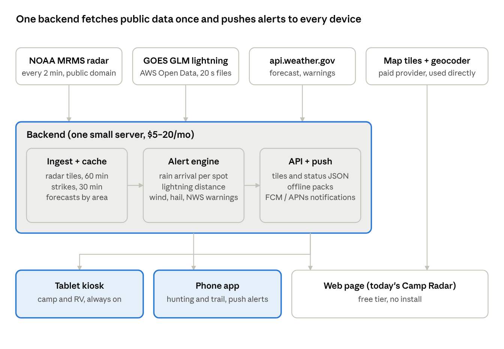
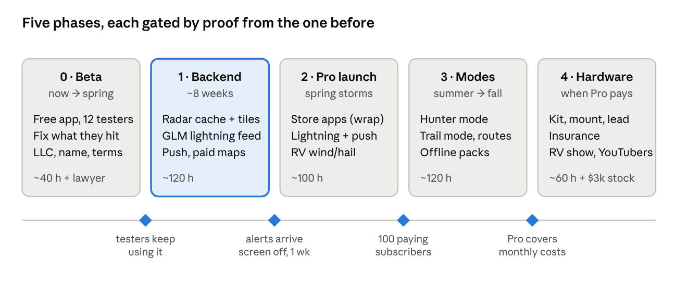

# Camp Radar Product Plan

Nov 5, 2026 · saturnengr

## Summary

The product is a weather warning for people who are outside: it tells you when weather is coming for your spot and how long you have. Four groups share that need: campers and overlanders, RVers, hunters, and hikers, runners and cyclists.

What exists today is a working web app (Camp Radar) hosted free on GitHub Pages: NOAA quality-controlled radar, a 50-minute loop, rain arrival prediction with chime and snooze, NWS warnings that break through snooze, a 3-day forecast banner, GPS or manual location, tablet and phone layouts. It runs on hobby-grade data sources that cannot be resold.

This plan decides three things: launch as a free app with paid modes (hardware kit second), build a small backend so every data source is one we may use commercially and alerts work with the screen off, and treat lightning as the core paid feature across all four groups. Organized youth-sports leagues are out of scope; that market needs certified detection and insurance we do not have.

## Who it's for

All four groups are outdoors with no roof, often with weak signal, and want one answer: will it hit me, and when. They differ in what "it" is and in how they hold the device.

| Segment | Device and setting | What they fear most | What they need beyond radar |
| --- | --- | --- | --- |
| Camping / overlanding | Mounted tablet in the trailer or tent, or a phone | Rain arriving overnight, lightning at the site | Offline resilience, low power, night mode |
| RV | Mounted tablet near the door or dinette | Wind (awnings, high-profile driving), hail (roofs, skylights) | Gust forecast with thresholds, hail alerts, 12/24 V power |
| Hunting | Phone, out of signal most of the day | Lightning in a stand, a front changing the day | 48-hour offline pack, wind direction, pressure trend, legal light and moon, red night screen |
| Hiking / running / cycling | Phone in a pocket, moving | Being caught far from the trailhead | Route-aware turn-back advice, pre-departure brief, push alerts with the screen off, battery care |

RVers are the likeliest buyers of a ready-made hardware kit. Hunters and trail users are phone-only and value the offline and push features most. Campers are the base case the current app already serves.

## The product

One app, one promise, with a free core that earns installs and reviews and paid modes that pay for the data and the backend.

**Free core (what Camp Radar does today, polished)**

- Filtered NOAA radar with a 50-minute loop, centered on GPS or a chosen spot, 10/30/50-mile rings
- Rain arrival prediction: time of arrival, direction, intensity; "passing north" when it will miss
- Chime with 1/2/4/8-hour snooze; tornado, severe thunderstorm, flash flood and flood warnings always break through
- Current conditions, wind and gusts, 3-day forecast
- Day and night modes, tablet kiosk layout, phone layout, home-screen install

**Pro (paid) features, in build order**

1. Push alerts that work with the screen off and the app closed
2. Lightning: strikes within 10/20/30 miles, approaching or receding, time since last strike nearby
3. RV mode: gust alerts above a chosen speed (awning in, high-profile warning), hail alerts from radar intensity
4. Hunter mode: 48-hour offline forecast pack, wind rose, pressure trend, sunrise/sunset and legal shooting light, moon phase, red-light night screen
5. Trail mode: pre-departure brief for the next 3 hours along a route, "storm reaches you in X, trailhead is Y away" turn-back advice, heat index and wind chill, daylight remaining
6. Multiple saved spots, campsite history

**Hardware kit (second step, RV and camping)**

A rugged 8-inch Android tablet pre-set in kiosk mode, a RAM-style mount, a fused 12/24 V to USB-C lead, and a one-page card. The buyer powers it up and it works. Parts cost about $150–200; sells for $300–400.

What we are not building: a certified lightning system for schools and leagues, a general-purpose weather app, or a social or tracking product.

## Data sources and licensing

The weather data is free and public domain; the maps, place search and lightning are where the current build leans on services meant for hobbyists. Every "replace" row below is handled by the backend in Phase 1.

| Data | Today | Commercial use | Plan |
| --- | --- | --- | --- |
| Radar (MRMS, quality-controlled) | NOAA mapservices.weather.noaa.gov, fetched by each device | Public domain | Keep. Fetch once on the backend, cache, serve tiles to users; no SLA from NOAA, so keep a fallback |
| Radar fallback (raw NEXRAD) | Iowa Environmental Mesonet | University goodwill service | Backup only; never the primary path for paying users |
| Forecast, conditions, warnings | api.weather.gov, per device | Public domain | Keep. Backend fetches per area and pushes alerts |
| Lightning | None yet | Blitzortung is non-commercial; paid networks $50–200+/mo | Use NOAA GOES GLM: free, public domain, 20-second files on AWS Open Data, \~1 min latency, \~5 mi resolution, cloud-to-ground not separated. Good for a consumer distance alarm; upgrade to a paid network if customers want strike precision |
| Basemap | OpenStreetMap public tile server | Forbidden for heavy or commercial use | Replace with MapTiler, Stadia or Protomaps (self-hosted), \~$0–50/mo at launch scale |
| Place search | Nominatim public server | Forbidden for commercial use | Replace with the map provider's geocoder |
| Map library | Leaflet | BSD licence | Keep |

Attribution stays visible for every source as its licence requires. NOAA data carries no warranty, which the terms of use must pass on to the customer.

## Architecture

Today every device fetches radar and forecasts itself and runs the rain prediction in the browser. That works for one trailer and fails for a product: it can't alert a phone whose screen is off, it hits hobby servers once per user, and it can't do lightning. The fix is one small backend that does the fetching, caching and prediction once, and pushes the result.

Built (Nov 5, 2026) as an ASP.NET Core 8 Web API in `backend/` of the repo, hosted on the existing SmarterASP.NET W1050 plan (dedicated app pool, free Let's Encrypt SSL, scheduled tasks). GitHub Actions builds, tests and packages it for IIS on every push. Push notifications use Web Push (VAPID) to the home-screen app, so no store listing is needed for alerts with the screen off; a store wrapper (Capacitor or a Trusted Web Activity) remains the route to the app stores later. Because shared IIS idles a quiet site, a control-panel Scheduled Task calls `/tick` every minute as the heartbeat alongside the app's own background loop.

The web page keeps working standalone (no backend) and gains a *Backend address* setting that turns on the shared radar cache, lightning on the map and in the status bar, and *Alerts on this device*.

## Pricing and packaging

Free gets people in; Pro pays for the servers and the lightning work; the kit is the high-ticket item for RVers who want zero setup.

| Tier | Price | What's in it | Who buys it |
| --- | --- | --- | --- |
| Free | $0 | Radar loop, rain arrival alerts with chime and snooze, NWS warnings, forecast banner, web and home-screen install | Everyone; the review and word-of-mouth engine |
| Pro | $29.99/year or $4.99/month (7-day trial) | Push alerts, lightning, RV mode, Hunter mode, Trail mode, saved spots | Hunters, RVers, serious trail users |
| Family / crew | $49.99/year, up to 5 devices | Pro on every phone in the camp | Families, hunting camps, riding groups |
| Hardware kit | $349 one-time, includes 1 year of Pro | Pre-set rugged tablet, mount, 12/24 V lead, card | RVers, overlanders, outfitters |

Stores take 15% of the first $1M a year, so Pro nets about $25 per annual subscriber. A one-time "lifetime" price is tempting but ties ongoing server and data costs to a payment made once; avoid it unless the lightning feed stays free.

Prices in USD, US market only at launch (NOAA data covers the US and territories).

## Legal and liability

A product that sounds tornado and lightning alarms will be blamed the first time it is silent, so the legal setup comes before the first paid customer, not after. None of this is legal advice; have a lawyer review the terms and the entity before launch.

- [ ] Form an LLC (Texas) before taking money; keep business banking separate
- [ ] Terms of use and privacy policy: "supplemental information, not a substitute for NOAA Weather Radio, official warnings or your own judgment"; no warranty on data or delivery; the same disclaimer on first launch and in the store listing
- [ ] Honest staleness in the UI: a prominent "radar is N minutes old" and "offline since" state (partly built today)
- [ ] Location privacy: positions stay on the device except the one spot sent to the backend for alerts; no sale or sharing of location data; state this plainly
- [ ] General and product liability insurance before shipping hardware; ask the insurer about the alerting use case specifically
- [ ] Trademark search (USPTO TESS) and domain check on the chosen name before any marketing
- [ ] Attribution lines for NOAA, the map provider and OpenStreetMap-derived data wherever their licences require
- [ ] Hardware: FCC and battery-shipping rules are the tablet maker's problem if we resell an off-the-shelf unit; a lithium battery shipping label is ours

What we never claim: detection of every strike, guaranteed warning lead time, or suitability for organized events, schools or workplaces.

## Go-to-market

Each segment gathers in a few places, so reaching them is cheap if the message is specific to them. The positioning is the warning, not the radar: *you're outside; it tells you when the weather is coming for you and how long you've got.*

**Name.** "Camp Radar" is the working title and describes only the free tier and one segment. Pick a short, ownable name that works for a hunter and a cyclist too, check the trademark and the .com, and rename before the store listing. Candidates to vet are an open decision below.

| Segment | Where they are | First move |
| --- | --- | --- |
| Camping / overlanding | Overland and camping forums, YouTube build channels, Reddit (r/overlanding, r/camping) | Share the free app with a build video of the trailer install; ask for feedback, not sales |
| RV | RV forums (iRV2, RV.net), Facebook owner groups, YouTube full-timers, RV shows | Wind and hail alerts are the hook; the hardware kit is the show product |
| Hunting | Hunting forums and Facebook groups, outfitters, OnX and HuntStand communities, outdoor retailer affiliate programs | Hunter mode launch before fall season; outfitters as a crew-plan channel |
| Hiking / running / cycling | Strava clubs, trail-running and MTB groups, AllTrails and Komoot users, bike shops and running stores | Route import from Strava or GPX; a "turn back" story on a group ride or trail run |

**Launch sequence**

1. Beta: a dozen people across the four groups use the free app for a season; their complaints set the Pro roadmap
2. Soft launch: store listings, a one-page site, a 60-second video, posts in the camping and RV communities
3. Pro launch with lightning and push, timed for spring storm season
4. Hunter mode by late summer; Trail mode and route import after that
5. Hardware kit once Pro has paying users and at least one RV show is on the calendar

Reviews and word of mouth matter more than ads at this scale; the first $1,000 of marketing should go to the video and to sending kits to two or three trusted YouTubers in the RV and overland space.

## Roadmap

Five phases, nights-and-weekends pace, each one started only when the previous phase has proved something. Hours are rough estimates for one person with Claude doing most of the coding.

Phase 1 is the one that matters: it removes every licensing problem, enables push and lightning, and is what the paid tier is built on. Status (7 Nov 2026): **done and live** — the backend runs at radar.tieroneehs.com (to become api.getleadtime.app) with cached radar, GLM lightning, push alerts, email sign-in, Pro entitlements with admin-issued activation codes, model-written briefings (Gemini first, Claude as fallback), the morning briefing push, and an admin dashboard. The paid map provider and geocoder swap is still open.

### Pro roadmap, agreed 7 Nov 2026

Three foundations, then feature phases that are thin layers on them.

**Foundations**
1. *Households* — a Pro owner invites family and friends; members inherit Pro; per-member consent for location sharing (always with an end time) and messages. **Built (Phase A below).**
2. *Saved sites* — named places on the account (home, the lease, the lake) with their own alerts, digest and thresholds; the device's current location stays separate.
3. *Server-side weather facts* — forecast assembly on the server (done for the morning briefing); add tides, SNOTEL, gauges, fire lines and the MRMS hail product so every feature can be evaluated for any site with no app open.

| Phase | Ships | Depends on | Effort |
| --- | --- | --- | --- |
| **A — Household** ✅ | Invites by email or code, consent screens, member list, leave/remove; people on the map with 24-hour trails (opt-in, timed); quick messages with reply chips, read aloud; "Weather turning — head back" with live status | 1 | done 7 Nov |
| **B — Sites & rules** | Saved sites; per-site alerts and morning digest; user thresholds (gust, low temperature, UV, visibility); dry-window finder; "leave by" | 2, 3 | ~1 week |
| **C — Hail & fishing** | Hail layer and alerts (MRMS MESH); Fishing activity (solunar, pressure, water temperature, lightning on open water) | 3 | ~1 week |
| **D — Travel** | Route weather for the drive (OSRM routing + forecast sampling); trip pack (offline forecast, radar, topo); clear-sky tonight; shareable camp card | 2 | ~1 week |
| **E — Native shell** | Capacitor app, Android first then iOS: background location that follows you, FCM/APNs push, home-screen widget; required for the app stores | A | 2–3 weeks + review |

Stripe is independent of all of this and goes in as soon as getleadtime.app resolves; it turns the Pro gate from admin-granted to self-serve. Supporting work that must exist alongside: privacy and consent copy (done for A), retention jobs (positions and messages 24 h, devices 90 days — done), rate limits on messaging (done), admin visibility of groups (done), and a first household of real testers before polish.

## Costs and break-even

Running costs are low because the weather data is free; about 40 annual Pro subscribers cover the monthly bill, and the one-time setup is roughly $1,500–2,500 before any hardware stock. Figures are estimates for the first year at small scale.

| Item | One-time | Monthly | Notes |
| --- | --- | --- | --- |
| LLC formation (Texas) | $300 | — | Plus registered agent if used, \~$100/yr |
| Terms and privacy policy review | $500–1,500 | — | Template plus a lawyer's hour or two |
| Trademark filing | $350 | — | Per class, if pursued |
| Apple and Google developer accounts | $25 | $8 | Apple $99/yr, Google $25 once |
| Backend hosting | — | $0 extra | Runs on the existing SmarterASP.NET W1050 plan; no new cost |
| Map tiles and geocoding | — | $0–50 | Free tier covers early use |
| Push notifications | — | $0 | FCM and APNs are free |
| Lightning data (GLM from AWS) | — | $0–10 | Egress only; a paid network later would add $50–200+ |
| Domain, email, site | $20 | $10 |  |
| Launch video and a few review units | $500–1,000 | — | Two or three tablets sent to reviewers |
| Hardware kit stock (Phase 4) | $3,000 | — | 15–20 kits at \~$170 parts each |
| Insurance (Phase 4) | — | $40–80 | General plus product liability |

At $25 net per annual Pro subscriber: 40 subscribers cover \~$80/month of running costs; 400 subscribers is $10,000/year, which pays back the setup and the first year of effort at a modest rate; 2,000 subscribers is a real side business. Each hardware kit nets roughly $120–150 after parts, the bundled year of Pro, shipping and payment fees.

The honest expectation: several months of unpaid evenings before the first dollar, and a modest earner unless the hardware kit or an outfitter and crew channel takes off.

## Open decisions and risks

**Decisions to make before Phase 1**

- [ ] Product name (shortlist, trademark and domain check)
- [ ] Store strategy: Android first (the tablet and most rugged phones) or both stores from day one (iPhone is most of the trail-running market)
- [ ] Trial length and whether the family plan ships at launch
- [ ] Map provider (MapTiler vs Stadia vs self-hosted Protomaps)
- [ ] Who the first dozen beta testers are, with at least two from each segment

**Risks and what we do about them**

| Risk | Likelihood | Effect | Response |
| --- | --- | --- | --- |
| NOAA service outage or format change | Medium | Radar or alerts go dark | Backend caches the last hour; IEM raw radar as fallback; loud "stale" state in the app |
| GLM lightning too coarse or late for user trust | Medium | Pro feels weak | Position it as distance bands, not strike points; upgrade to a paid network once revenue covers it |
| A missed warning blamed on the app | Low per user, certain at scale | Legal and reputational | LLC, terms, disclaimers in the UI, insurance; never claim completeness |
| Established apps add the same alerts | Medium | Harder to stand out | Compete on the niche modes and the kit, not on radar |
| Phone power management kills background alerts | High on some Android brands | Alerts arrive late | Push from the backend (not the app polling); setup guide per brand; honest "keep the app open for alarms" guidance |
| Hardware returns and support load | Medium | Time sink | Off-the-shelf tablet with the maker's warranty; one-page setup; small first batch |
| Builder burnout (one person, evenings) | High | Project stalls | Gates between phases; the free app stands alone if work stops |
